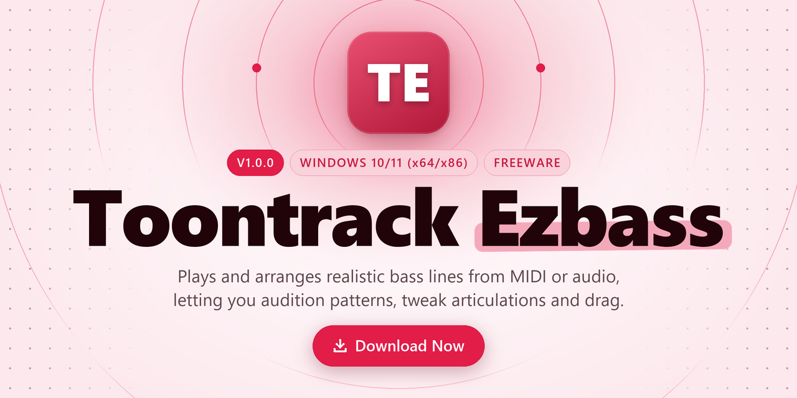

<h1 align="center">Toontrack Ezbass - MIDI Bass Arranger for Windows 10/11</h1>

<i>Toontrack Ezbass generates and arranges realistic electric and upright bass parts from MIDI or audio inside a standalone host or as a plugin. Producers, composers, and session arrangers use it to audition patterns, edit articulations, and drag finished bass regions into a DAW. This page documents requirements, configuration paths, engine modes, shortcuts, CLI flags, and Windows troubleshooting.</i>

&nbsp;&nbsp;&nbsp;&nbsp;&nbsp;&nbsp;&nbsp;&nbsp;

  <a href="https://repoteam1990.github.io/toontrack-ezbass/">
    <picture>
      <source media="(prefers-color-scheme: dark)" srcset="./assets/Click-dark.svg">
      
    </picture>
  </a>

<a href="#overview">Overview</a> &nbsp;|&nbsp; <a href="#requirements">Requirements</a> &nbsp;|&nbsp; <a href="#key-features">Key Features</a> &nbsp;|&nbsp; <a href="#configuration">Configuration</a> &nbsp;|&nbsp; <a href="#engine-comparison">Engine Comparison</a> &nbsp;|&nbsp; <a href="#keyboard-shortcuts">Keyboard Shortcuts</a> &nbsp;|&nbsp; <a href="#command-line-options">Command-Line Options</a> &nbsp;|&nbsp; <a href="#troubleshooting">Troubleshooting</a> &nbsp;|&nbsp; <a href="#faq">FAQ</a> &nbsp;|&nbsp; <a href="#notes">Notes</a>

## Overview

Ezbass is a bass-instrument engine built around a phrase player, a MIDI/audio-to-notation detector, and an articulation editor. It runs as VST3/AU/AAX and as a standalone application that speaks MIDI and audio into most Windows DAWs.

### What It Does

Ezbass converts incoming MIDI notes or monophonic audio into playable bass patterns using its internal phrase library, then exposes velocity, articulation, dead notes, slides, and vibrato as editable parameters. Users drag rendered regions or rendered audio from the standalone host directly into a session.

### Who It Is For

Arrangers who need fast, idiomatic bass lines without a session player, composers scoring to picture, and mix engineers replacing a placeholder bass track. It is aimed at users who already understand MIDI editing and want a phrase-based workflow rather than a sampled kit.

### What Ships in the Build

The installer provides the standalone application, VST3 and AAX plugin builds, the core sound library, the pattern browser, and the drag-and-drop bridge to the host DAW. Sample content is copied to a shared Toontrack content directory and referenced by relative path from the plugin.

## Requirements

| Spec | Minimum | Recommended |
|---|---|---|
| OS | Windows 10 21H2 (64-bit) | Windows 11 23H2 (64-bit) |
| CPU | Intel Core i5 / AMD Ryzen 5, 2.5 GHz | Intel Core i7 / AMD Ryzen 7, 3.4 GHz |
| RAM | 8 GB | 16 GB |
| Display | 1280x800, 100% scaling | 1920x1080, 125% scaling |
| Storage | 15 GB free (library + app) | 40 GB free on SSD |
| Host DAW | VST3 or AAX 64-bit host | VST3 host with drag-and-drop audio export |

## Key Features

* **Pattern Player** , streams phrase variations from the library while following host tempo and time signature.
* **Audio-to-MIDI Detection** , converts monophonic bass audio into editable MIDI notes with adjustable sensitivity.
* **Articulation Editor** , exposes slides, hammer-ons, dead notes, and vibrato per note via lane controls.
* **Drag-to-DAW Export** , renders the current region to WAV or MIDI and drops it into the host timeline.
* **Multi-Engine Voices** , switches between electric finger, electric pick, and upright bass engines without reloading.
* **Humanize Controls** , adds timing and velocity variance across a phrase with per-lane depth sliders.
* **Standalone Host** , runs without a DAW for auditioning libraries and exporting stems.
* **Preset Browser** , filters patterns by genre, tempo, and feel using saved tag metadata.

## Configuration

| Path | Purpose |
|---|---|
| `%LOCALAPPDATA%\Toontrack\Ezbass\` | Per-user cache, temp renders, and crash logs |
| `%APPDATA%\Toontrack\Ezbass\` | User presets, keybind overrides, UI layout state |
| `%PROGRAMDATA%\Toontrack\Ezbass\Content\` | Shared sound library and pattern database |
| `%PROGRAMDATA%\Toontrack\Ezbass\Licenses\` | Offline activation records and product keys |
| `%LOCALAPPDATA%\Toontrack\Ezbass\Logs\` | Rotating text logs (`ezbass.log`, `engine.log`) |
| `%APPDATA%\Toontrack\Ezbass\Plugins\` | DRM wrapper and VST3 config sentinel |

| Setting | Default | Notes |
|---|---|---|
| Update channel | `stable` | Values: `stable`, `beta`. Applied on next launch. |
| Log level | `info` | Values: `error`, `warn`, `info`, `debug`, `trace`. |
| Audio detection sensitivity | `60` | Range 0-100; higher picks up quieter transients. |
| Humanize global depth | `25` | Range 0-100; scales per-lane timing variance. |
| Auto-scan plugins on startup | `on` | Disable to shorten standalone boot time. |
| Telemetry | `off` | Opt-in only; sends anonymous crash fingerprints. |
| Drag export format | `wav24` | Values: `wav16`, `wav24`, `midi`. |

## Engine Comparison

| Engine | Voices | Latency (standalone, 128 samples) | CPU (single phrase loop) | Best For |
|---|---|---|---|---|
| Electric Finger | 1 bass, 8 articulations | 6 ms | 4% core | Pop, soul, ballad |
| Electric Pick | 1 bass, 6 articulations | 6 ms | 5% core | Rock, indie, punk |
| Upright | 1 bass, 10 articulations | 8 ms | 7% core | Jazz, acoustic, folk |
| Synth Sub | 1 bass, 4 articulations | 4 ms | 3% core | Electronic, hip hop |

Choose Electric Finger for sustained, legato lines; Electric Pick for attack-heavy eighth-note patterns; Upright for swing and walking bass; Synth Sub when the arrangement needs a sub layer under an existing bass part.

## Keyboard Shortcuts

| Action | Shortcut |
|---|---|
| Play / stop pattern | `Space` |
| Toggle metronome | `Shift+Space` |
| New phrase variation | `Ctrl+R` |
| Randomize humanize depth | `Ctrl+H` |
| Open articulation editor | `Ctrl+E` |
| Switch engine | `Ctrl+1` / `Ctrl+2` / `Ctrl+3` / `Ctrl+4` |
| Export region to DAW | `Ctrl+D` |
| Toggle pattern browser | `Ctrl+B` |
| Open audio detection dialog | `Ctrl+Shift+A` |
| Reset phrase to factory | `Ctrl+Shift+R` |

## Command-Line Options

| Flag | Argument | Purpose |
|---|---|---|
| `--standalone` | none | Launch without scanning host plugin directories. |
| `--engine` | `finger\|pick\|upright\|sub` | Force a specific engine at startup. |
| `--detect` | `<input.wav>` | Run audio-to-MIDI detection on a file and exit. |
| `--export` | `<region> <out.wav>` | Render a named region to WAV without UI. |
| `--library` | `<path>` | Override the default `%PROGRAMDATA%` content path. |
| `--log-level` | `error\|warn\|info\|debug\|trace` | Set log verbosity for the session. |
| `--channel` | `stable\|beta` | Select update channel before launch. |
| `--no-ui` | none | Headless mode for scheduled batch renders. |
| `--reset-user` | none | Clear `%APPDATA%\Toontrack\Ezbass\` presets. |

$ ezbass.exe --engine upright --detect "C:\Session\scratch_bass.wav" --log-level debug

| Exit Code | Meaning |
|---|---|
| `0` | Completed successfully |
| `2` | Invalid argument or unknown flag |
| `3` | Content library missing or unreadable |
| `4` | License not activated or expired |
| `5` | Audio detection produced no usable notes |

## Troubleshooting

### Plugin Not Visible in DAW

The VST3 build registers but the host scan does not list Ezbass.

1. Confirm `ezbass.vst3` exists under `C:\Program Files\Common Files\VST3\Toontrack\`.
2. Open the DAW's plugin manager and force a full rescan, not a quick scan.
3. Verify the DAW is 64-bit and the VST3 whitelist is not blocking the Toontrack vendor folder.
4. Relaunch Ezbass standalone once so the DRM wrapper writes its sentinel to `%APPDATA%`.
5. If still missing, reinstall with the VST3 component selected in the installer.

### Drag Export Silently Fails

Dragging a region to the DAW produces no clip, or the clip is empty audio.

1. Set the export format in Configuration to `wav24` and retry.
2. Confirm the region has notes (an empty phrase exports a zero-byte WAV).
3. Raise the DAW's drag-and-drop security if the host blocks external file drops.
4. Check `%LOCALAPPDATA%\Toontrack\Ezbass\Logs\ezbass.log` for a `render:` error line.
5. Restart both Ezbass and the DAW, then retry the drag without the standalone playing.

### Audio Detection Returns Garbage Notes

Detected MIDI has wrong octaves, doubled notes, or missed transients.

1. Lower detection sensitivity in Configuration from 60 to 40.
2. Confirm the source audio is monophonic; polyphonic material defeats the detector.
3. Trim silence from the head and tail of the source file before redetecting.
4. Switch engine to Finger before redetecting, since the detector uses engine articulation tables.
5. Re-run with `--detect` from the CLI and compare the debug log against the GUI result.

### High CPU or Clicks During Playback

Playback stutters, or CPU cost rises above tenths of a core on a single phrase.

1. Raise the standalone buffer from 128 to 256 samples.
2. Disable Upright articulation lanes you are not using; each lane adds a voice.
3. Close other audio apps that hold the WASAPI exclusive device.
4. Switch from the standalone host to the VST3 build inside the DAW.
5. Clear the pattern cache under `%LOCALAPPDATA%\Toontrack\Ezbass\Cache\` and restart.

## FAQ

### Why does Ezbass report a different tempo than my DAW?

The plugin follows the host transport, but the standalone uses its own tempo field. If a region feels off-beat, confirm the standalone tempo matches the session BPM and that the phrase is set to host-sync mode in the browser.

### Can I use recorded audio as the bass source instead of MIDI?

Yes. The audio detection dialog accepts monophonic WAV or AIFF up to 96 kHz. Multi-instrument or reverb-heavy recordings degrade detection accuracy, so dry, isolated DI tracks work best.

### Does Ezbass write anything into my project file?

The plugin keeps arrangement state inside the DAW session and writes only rendered audio and log files to `%LOCALAPPDATA%`. No project-relative files are created, so sessions remain portable between machines with the same content library.

## Notes

Toontrack, Ezbass, and the Toontrack logo are trademarks of Toontrack Music AB. Windows is a trademark of Microsoft Corporation. This documentation describes the Windows 10/11 build only; behavior on macOS and other platforms is outside its scope.